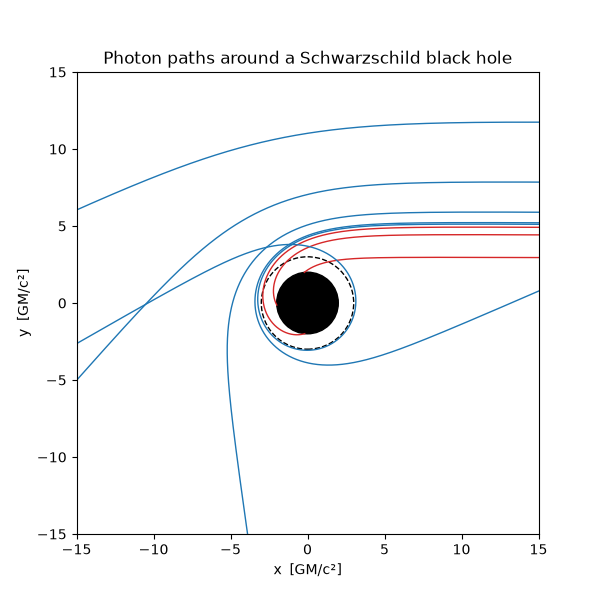

# black-hole-photon-orbits
# Photon paths around a Schwarzschild black hole

A small Python program that traces light rays past a non-rotating black hole,
finds the critical impact parameter that separates captured from escaping rays,
and checks the weak-field light bending against the standard result.

## Physics
I use units with $G = c = 1$, so lengths are in units of $GM/c^2$ and the event
horizon sits at $r = 2M$. For a light ray in the equatorial plane, write $u = 1/r$
and let $\phi$ be the angle around the hole. The orbit equation is

$$\frac{d^2 u}{d\phi^2} + u = 3Mu^2 .$$

A ray coming from far away with impact parameter $b$ starts at $u_0 = 10^{-3}$
($r_0 = 1000\,M$) with

$$\left(\frac{du}{d\phi}\right)_0 = \sqrt{\frac{1}{b^2} - u_0^2\,(1 - 2Mu_0)} .$$

The integration stops when the ray reaches the horizon ($u = 1/2M$, captured)
or returns to $r_0$ (escaped).

Two known results are used as checks:
- The photon sphere is at $r = 3M$.
- The critical impact parameter is $b_{\rm crit} = 3\sqrt{3}\,M \approx 5.196\,M$.
  Rays with $b < b_{\rm crit}$ are captured and rays with $b > b_{\rm crit}$ escape.
  A distant observer sees the black hole's shadow with this radius.
- For large $b$, the light bending angle approaches $4M/b$.

## Results

Red paths are captured and blue paths escape. The black disk is the event horizon
and the dashed circle is the photon sphere at $r = 3M$. The ray with $b = 5.2$ loops
around close to the photon sphere before escaping.

**Critical impact parameter (bisection):** $b = 5.196152$, compared with the exact
value $3\sqrt{3}\,M = 5.196152$.

**Weak-field deflection:**

| $b$ | simulated | $4M/b$ |
|---|---|---|
| 50 | 0.0851 | 0.0800 |
| 100 | 0.0412 | 0.0400 |
| 200 | 0.0203 | 0.0200 |

The simulated angle approaches $4M/b$ as $b$ grows. The remaining difference at
smaller $b$ comes from higher-order corrections.

## Limitations
- Non-rotating (Schwarzschild) black hole only; no spin.
- Rays in the equatorial plane only.
- The bisection treats any ray that is not captured within the integration range
  ($6\pi$ radians) as escaped, which limits the accuracy very close to $b_{\rm crit}$.
- No accretion disk or image rendering.

## Run
Needs `numpy`, `scipy` and `matplotlib`. Run `python photon_orbits.py`.

## Possible next steps
- Include a thin accretion disk and render an image.
- Extend to the Kerr (rotating) black hole.

## References
- P. Olesen, *General Relativity and Cosmology*, lecture notes. Sec. 1.20: derivation of the Schwarzschild metric (Eq. 1.229).
- O. Witt-Hansen, *General Relativity and Cosmology* (2016), lecture notes. Sec. 3.3: Schwarzschild solution; Sec. 3.4: deflection of a light ray; Sec. 3.5.6: orbital motion around a black hole (effective potential and photon orbits).
